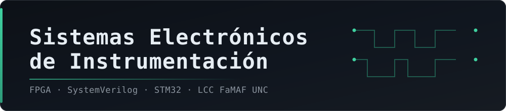

<div align="center">




</div>

---

Material de la cursada 2026: apuntes de la cátedra, bibliografía y los laboratorios con su código e informe.

## Laboratorios

| | Plataforma | Estado | Contenido |
|---|---|---|---|
| **[1 — Frecuencímetro sobre FPGA](./laboratorio-1-frecuencimetro-fpga)** | Boolean Board · Spartan-7 `xc7s50csga324-1` | Entregado | 7 módulos SystemVerilog, restricciones y informe |
| **[2 — Concurrencia sobre STM32](./laboratorio-2-concurrencia-stm32)** | STM32F411E-DISCO · CubeIDE (HAL) | Sin empezar | Consigna: 6 desafíos de complejidad ascendente |

## Teoría

| Unidad | Material |
|---|---|
| [`01-intro-sistemas-embebidos/`](./teoria/01-intro-sistemas-embebidos) | Presentación de la cátedra y *Embedded Market Study* 2023 |
| [`02-fpgas/`](./teoria/02-fpgas) | Presentación de introducción a FPGAs y tutorial de FPGA, SystemVerilog y Vivado |

## Bibliografía

| Archivo | Referencia |
|---|---|
| [`electronics-for-embedded-systems.pdf`](./bibliografia) | *Electronics for Embedded Systems* — Bindal (Springer, 2017) |
| [`sutherland-systemverilog-for-design.pdf`](./bibliografia) | *SystemVerilog for Design*, 2.ª ed. — Sutherland, Davidmann, Flake & Moorby (Springer, 2006) |
| [`intro-systemverilog.pdf`](./bibliografia) | Introducción a SystemVerilog |

## Convención de carpetas

La misma estructura se repite en cada laboratorio:

| Carpeta | Qué contiene |
|---|---|
| `consigna/` | Guía oficial de la cátedra |
| `src/` | Código propio, listo para sintetizar o compilar |
| `src-catedra/` | Esqueleto y módulos provistos, sin modificar |
| `informe/` | Fuente LaTeX, PDF entregado y evidencia de la medición |

<details>
<summary><b>Árbol completo del repositorio</b></summary>

```
Sistemas Electronicos de Instrumentacion/
├── bibliografia/
│   ├── electronics-for-embedded-systems.pdf
│   ├── intro-systemverilog.pdf
│   └── sutherland-systemverilog-for-design.pdf
├── teoria/
│   ├── 01-intro-sistemas-embebidos/
│   │   ├── introduccion-sistemas-embebidos-2026.pdf
│   │   └── embedded-market-study-2023.pdf
│   └── 02-fpgas/
│       ├── presentacion-intro-fpga.pdf
│       └── iniciacion-fpga-systemverilog-vivado.pdf
├── laboratorio-1-frecuencimetro-fpga/
│   ├── README.md
│   ├── consigna/
│   │   └── lab1-frecuencimetro.pdf
│   ├── src/                     módulos propios + restricciones
│   ├── src-catedra/             esqueleto provisto, sin modificar
│   └── informe/
│       ├── informe_lab1.tex
│       ├── informe_lab1 - VillarPedro.pdf
│       ├── foto_medicion.jpg / foto_generador.jpg / foto_displays.jpg
│       ├── Frequency_meter_utilization_placed.rpt
│       └── reporte_utilizacion.tcl
└── laboratorio-2-concurrencia-stm32/
    ├── README.md
    ├── consigna/
    │   └── guia-laboratorio-stm32.pdf
    └── src/
```

</details>

---

<div align="center">

*Licenciatura en Ciencias de la Computación — FaMAF, Universidad Nacional de Córdoba.*

</div>
