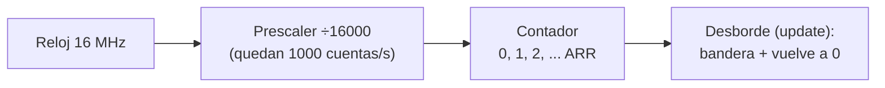
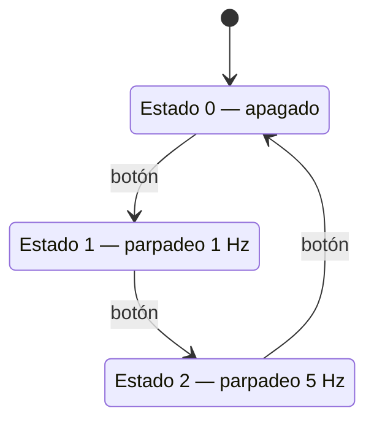
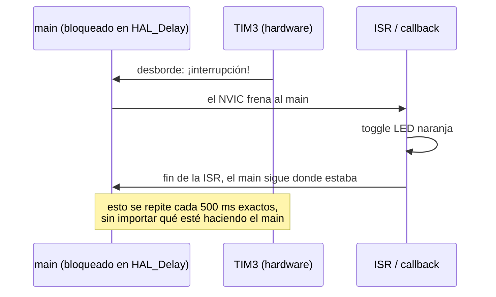
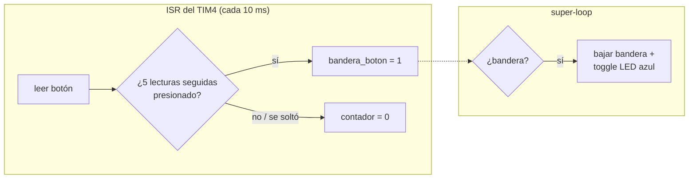

# Explicación de los desafíos

El hilo del laboratorio es uno solo: **cómo hacer varias cosas "a la vez" con un solo procesador**. Se arranca con la peor solución (frenar todo con `HAL_Delay`) y se termina con la mejor (el hardware interrumpe al programa solo cuando hace falta).

El código está en [`firmware/desafios/`](./firmware/desafios), un archivo por desafío. Cómo compilar y grabar cada uno: [`setup.md`](./setup.md).

## Conceptos que se usan en todos

**Super-loop:** el `main()` de un embebido no termina nunca — inicializa todo una vez y después da vueltas en un `while(1)` para siempre. Todo lo que el programa "hace" pasa adentro de ese loop.

**HAL:** la librería de ST que envuelve los registros del chip en funciones legibles: `HAL_GPIO_ReadPin` lee un pin, `HAL_GPIO_TogglePin` lo invierte, `HAL_Delay(ms)` espera bloqueando, `HAL_GetTick()` devuelve los milisegundos desde el arranque.

**El botón de la Nucleo es activo en bajo:** suelto se lee `1` (`GPIO_PIN_SET`), presionado se lee `0` (`GPIO_PIN_RESET`) — al revés que en la guía, que usa la placa Discovery. Por eso en todo el código "presionado" se compara contra `GPIO_PIN_RESET`.

**La cuenta de los timers** (se hace una vez y vale para TIM2, TIM3 y TIM4): el timer recibe un reloj de 16 MHz. El **prescaler** lo divide: con `PSC = 16000-1` el contador avanza a 16 MHz / 16000 = 1 kHz, o sea **una cuenta por milisegundo**. El contador cuenta 0, 1, 2… hasta el valor del **ARR** (período) y ahí "desborda": levanta una bandera y vuelve a cero. Entonces el período en ms se escribe directo en el ARR: `ARR = 100-1` → desborda cada 100 ms.



**El rebote:** un pulsador no pasa de 0 a 1 limpio — los contactos metálicos "rebotan" unos milisegundos y el pin lee varios 0↔1 falsos. Si no se filtra, una presión cuenta como varias. Todos los desafíos con botón lidian con esto de alguna forma.

---

## Desafío 1 — Antirrebote bloqueante

**Qué hace:** cada presión del botón invierte el LED rojo.

**Cómo funciona:** cuando lee el botón presionado, espera 50 ms (`HAL_Delay`) y lo vuelve a leer. Si sigue presionado, era una presión real (el rebote dura menos de 50 ms) → hace el toggle. Después se queda en un `while` esperando que se suelte, para que mantener el botón apretado no dispare mil toggles.

**La idea clave:** detectar el **flanco** (el momento de presionar) y no el **nivel** (que esté presionado). Funciona, pero al costo de que el procesador se queda clavado esperando: mientras dura el `HAL_Delay` o el while de "soltá el botón", no puede hacer **nada más**.

## Desafío 2 — Temporización cooperativa

**Qué hace:** el LED azul parpadea a 2 Hz y, al mismo tiempo, el verde se enciende solo mientras el botón está presionado.

**Cómo funciona:** en vez de `HAL_Delay(250)`, el loop compara en cada vuelta: "¿ya pasaron 250 ms desde el último cambio?" usando `HAL_GetTick()`. Si pasaron, hace el toggle y anota la hora. Si no, sigue de largo — y esa vuelta la aprovecha para leer el botón.

```c
if (millisActual - millisAnterior >= 250) {
    millisAnterior = millisActual;
    HAL_GPIO_TogglePin(...);
}
```

**La idea clave:** el loop gira miles de veces por segundo sin frenarse nunca, y cada tarea decide por sí misma si "le toca" hacer algo en esta vuelta. Por eso el botón responde al instante aunque el LED tenga su propio ritmo. Esto es concurrencia **cooperativa**: las tareas conviven porque ninguna bloquea.

## Desafío 3 — Máquina de estados

**Qué hace:** cada presión del botón rota entre 3 estados: todo apagado → todo parpadeando lento (1 Hz) → todo parpadeando rápido (5 Hz) → vuelta a apagado.



**Cómo funciona:** junta las dos técnicas anteriores. El botón se detecta por flanco **comparando la lectura actual con la anterior** (recién presionado = ahora `0`, antes `1`); una variable `estado` guarda en qué estado está, y el parpadeo usa el esquema no bloqueante del desafío 2, cambiando solo el período según el estado (500 ms o 100 ms).

**La idea clave:** la variable `estado` es la **memoria** del sistema: el loop no "recuerda" nada entre vueltas salvo lo que guardás explícitamente. Botón y parpadeo son independientes — por eso la respuesta al botón es inmediata sin importar qué tan rápido parpadee.

## Desafío 4 — Timer de hardware por polling

**Qué hace:** secuencia "Coche Fantástico": verde → naranja → rojo → azul → rojo → naranja → … , un paso cada 100 ms.

**Cómo funciona:** el TIM2 está configurado (en CubeMX) para desbordar cada 100 ms. El procesador ya no cuenta tiempo: solo pregunta en el loop si el timer levantó la bandera de desborde (`__HAL_TIM_GET_FLAG`). Si está levantada, la limpia y avanza la secuencia un paso. La secuencia es un contador `paso` de 0 a 5 que elige qué LED encender (ida y vuelta: 6 pasos que se repiten).

**La idea clave:** medir tiempo pasa a ser trabajo del **periférico**, no del procesador. El SysTick (lo que usa `HAL_GetTick`) depende del procesador; un timer dedicado cuenta solo, con precisión de hardware. Pero ojo: el procesador todavía tiene que **preguntar** (polling) — si el loop estuviera ocupado, se enteraría tarde.

## Desafío 5 — Interrupciones

**Qué hace:** el LED naranja parpadea a 1 Hz perfecto **aunque el main esté bloqueado** con un `HAL_Delay(5000)`. El verde cambia cada 5 segundos para que se note lo lento que avanza el main.

**Cómo funciona:** el TIM3 desborda cada 500 ms y, en vez de levantar una bandera para que alguien la mire, dispara una **interrupción**: el hardware (NVIC) frena al main donde esté, ejecuta la rutina de atención (ISR) — que acá termina llamando al callback `HAL_TIM_PeriodElapsedCallback`, donde se invierte el naranja — y devuelve el control al main como si nada.



**La idea clave:** esto es concurrencia **preemptiva**: la tarea urgente no espera a que el main le dé permiso — lo **interrumpe**. Comparar con el desafío 4: mismo timer, pero ahora nadie tiene que preguntar.

## Desafío 6 — Antirrebote por muestreo en ISR

**Qué hace:** lo mismo que el desafío 1 (una presión = un toggle, acá del LED azul), pero sin bloquear jamás el main.

**Cómo funciona:** el TIM4 interrumpe cada 10 ms y el callback lee el botón. Un contador cuenta lecturas seguidas en "presionado": al llegar a 5 (= 50 ms estable, el rebote ya pasó seguro) levanta la bandera `bandera_boton`. Si en el medio lee "suelto", el contador vuelve a 0 — así el ruido nunca llega a 5. El main solo hace: si la bandera está levantada, la bajo y hago el toggle.



**La idea clave:** la ISR y el main se comunican por una **variable compartida**, y esa variable tiene que ser `volatile`. Sin `volatile`, el compilador ve que el main nunca escribe `bandera_boton` y "optimiza": la lee una sola vez y asume que vale 0 para siempre — el toggle no ocurriría nunca. `volatile` le ordena ir a memoria en cada lectura porque el valor puede cambiar por fuera del flujo normal (lo cambia la interrupción).

**Detalle fino** (puede caer de pregunta): el contador llega a 5 y la bandera se levanta **una sola vez** por presión; mantener apretado no repite el toggle hasta soltar… salvo que lo mantengas tanto que el contador de 8 bits dé la vuelta (256 × 10 ms ≈ 2,5 s) y vuelva a pasar por 5. Es el comportamiento de la pista de la cátedra, tal cual.

---

## El mapa completo

| Desafío | ¿Quién cuenta el tiempo? | ¿Quién se entera y cómo? | ¿El main se bloquea? |
|---|---|---|---|
| 1 | el procesador (`HAL_Delay`) | — | sí, todo el tiempo |
| 2–3 | el SysTick (`HAL_GetTick`) | el main pregunta en cada vuelta | no |
| 4 | un timer de hardware | el main pregunta (polling de la bandera) | no, pero tiene que preguntar |
| 5–6 | un timer de hardware | el timer interrumpe al main (ISR) | puede bloquearse y no importa |
