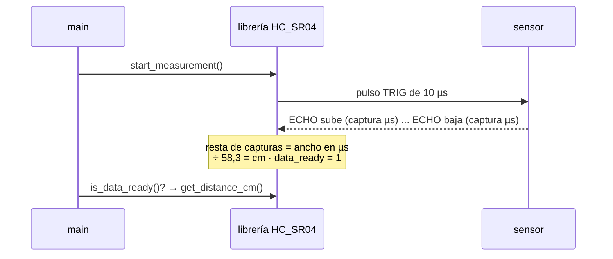
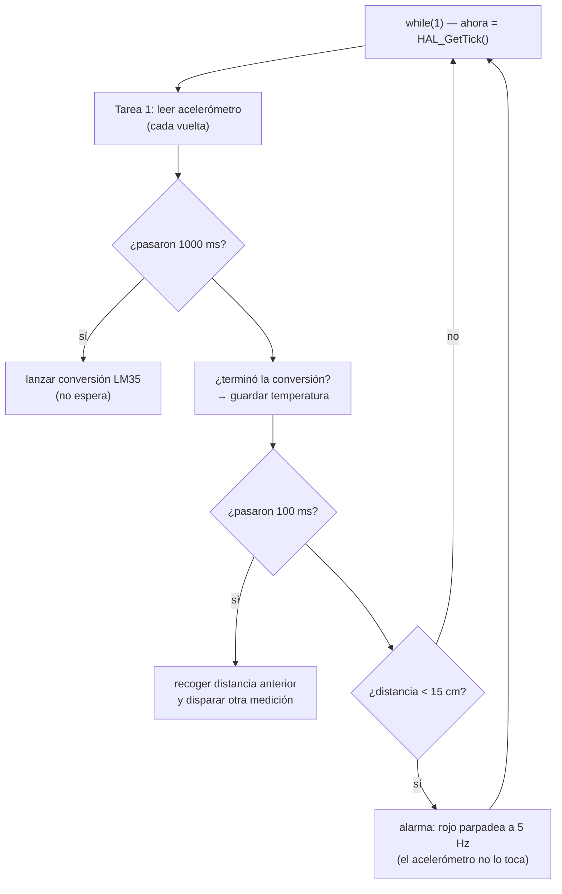

# Explicación de los desafíos

Si el lab 2 fue sobre **cómo repartir el tiempo** del procesador, este es sobre **cómo entra el mundo exterior** al micro: tres sensores, cada uno por una vía distinta — un pulso digital que hay que cronometrar (HC-SR04), una tensión analógica que hay que convertir a número (LM35) y un chip que habla por protocolo serie (acelerómetro). Y de yapa, cómo se empaqueta el manejo de un sensor en una librería.

El código está en [`firmware/desafios/`](./firmware/desafios), un archivo por desafío; las librerías en [`firmware/libs/`](./firmware/libs). Cómo compilar, grabar y cablear: [`setup.md`](./setup.md).

## Las tres vías de entrada

**Pulso digital cronometrado (HC-SR04):** el sensor manda un ultrasonido y pone su pin Echo en alto exactamente mientras espera el rebote. La distancia *es* la duración de ese pulso: 58,3 µs por cm. Medir "cuánto duró un pulso" con precisión de microsegundos es trabajo para el modo **Input Capture** de un timer: el contador corre libre a 1 MHz (1 cuenta = 1 µs) y, cuando el pin cambia, el hardware **fotografía** el valor del contador en un registro e interrumpe. Restando la foto del flanco de subida a la del de bajada queda el ancho del pulso, sin que el procesador cuente nada.

**Tensión analógica (LM35):** el LM35 saca 10 mV por cada °C (25 °C → 250 mV). El **ADC** convierte esa tensión en un número: con 12 bits, 0 V → 0 y 3,0 V → 4095. La conversión lleva tiempo (por eso existe la versión bloqueante y la no bloqueante de leerlo). La cuenta para volver a grados:

```
grados = (cuentas × 3000 mV / 4095) / 10 mV
```

**Protocolo serie (LIS3DSH por SPI):** el acelerómetro ya mide y convierte solo; adentro tiene **registros** (casilleros numerados) con la aceleración de cada eje. SPI es la forma de leerlos: el micro (master) baja el **CS** para elegir al chip, manda la dirección del registro (con el bit 7 en 1 si es lectura), el chip contesta el dato, y CS vuelve a subir. La aceleración incluye la gravedad, así que con la placa quieta los valores de X e Y dicen hacia dónde está inclinada.

---

## Desafío 1 — HC-SR04 y librerías de terceros

**Qué hace:** radar de proximidad. Verde si hay más de 50 cm libres, naranja entre 20 y 50, rojo a menos de 20.

**Cómo funciona:** acá no escribimos el manejo del sensor — integramos la librería `HC_SR04` de la cátedra, que es como se trabaja en la industria. El contrato de la librería tiene tres partes:

1. **Llenar la estructura** `HCSR04_HandleTypeDef` con los recursos que le tocan (qué timer, qué canal, qué pin de trigger) y llamar `hcsr04_init`.
2. **Usar la API**: `hcsr04_start_measurement` dispara (y vuelve enseguida), `hcsr04_is_data_ready` dice si ya hay dato, `hcsr04_get_distance_cm` lo devuelve.
3. **Conectarle las interrupciones**: la HAL llama a `HAL_TIM_IC_CaptureCallback` en cada captura; nuestro único trabajo es pasarle esa llamada a `hcsr04_tim_ic_callback`, que es quien sabe interpretar los flancos.



**La idea clave:** la librería expone *qué* se puede hacer (el `.h`) y esconde *cómo* lo hace (el `.c`). El main queda corto y legible, y el conocimiento fino del sensor vive en un solo lugar.

## Desafío 2 — LM35 y la librería propia

**Qué hace:** nuestra propia librería (`lm35.h`/`lm35.c`), con el diseño que pide la consigna: multi-instancia y con dos APIs — bloqueante y no bloqueante.

**Cómo funciona la multi-instancia:** la librería no tiene ninguna variable global. Todo lo que define a un sensor (qué ADC, qué canal) vive en una estructura `LM35_HandleTypeDef`, y cada función recibe un puntero a la instancia sobre la que trabaja. Podés tener `lm35_1`, `lm35_2`, … y cada una sabe lo suyo. Antes de cada conversión, la instancia apunta el secuenciador del ADC a *su* canal (`HAL_ADC_ConfigChannel`) — así varias instancias comparten un mismo ADC sin pisarse.

**Las dos APIs** (es el mismo contraste del lab entero, metido dentro de una librería):

- **Fase A, bloqueante:** `LM35_Read_Blocking` dispara, se queda esperando (`HAL_ADC_PollForConversion`) y devuelve los grados. Simple de usar, pero clava al procesador mientras el ADC convierte.
- **Fase B, no bloqueante:** `LM35_Start_Conversion` dispara y vuelve al toque; `LM35_Get_Temperature` pregunta "¿terminaste?" sin esperar (timeout 0): si hay dato lo devuelve por puntero y retorna `true`, si no retorna `false` y el main sigue con su vida. Mismo patrón que `is_data_ready` de la librería del desafío 1.

**La idea clave (va a examen):** una librería de sensor bien diseñada **no configura el hardware** (eso es de CubeMX/HAL) — **administra recursos ya configurados** y los asocia a instancias. Y nota fina: dos instancias pueden *existir* sobre el mismo ADC, pero no pueden *convertir* al mismo tiempo — el periférico físico es uno solo; la librería multiplica sensores lógicos, no hardware.

## Desafío 3 — El acelerómetro y el problema del bloqueo

**Qué hace:** los LEDs señalan hacia dónde se inclina la placa (se lee X e Y del LIS3DSH por SPI). Encima corre un "latido": el LED azul parpadeando cada 500 ms. El experimento es implementar ese latido de las dos maneras (el `#define HEARTBEAT_BLOQUEANTE` al principio del archivo) y **ver** la diferencia:

- **Con `HAL_Delay(500)`:** el loop completo queda preso del delay. El acelerómetro se lee 2 veces por segundo y los LEDs direccionales cambian a los tirones, medio segundo tarde.
- **Con `HAL_GetTick()`:** el loop gira miles de veces por segundo; el azul parpadea exactamente igual, pero la inclinación responde al instante.

**La idea clave:** es la demostración empírica de lo que el lab 2 contaba con un botón: `HAL_Delay` no frena "una tarea" — frena **todas**, porque en un super-loop hay un solo hilo. La regla práctica: un delay bloqueante solo es tolerable si no hay ninguna otra tarea que atender.

## Desafío 4 — El super-loop y la integración total

**Qué hace:** todo junto. El acelerómetro maneja los LEDs direccionales en cada vuelta; la temperatura se consolida una vez por segundo; la distancia se mide 10 veces por segundo; y si aparece un obstáculo a menos de 15 cm, el LED rojo abandona al acelerómetro y parpadea a 5 Hz hasta que se despeje. Cero `HAL_Delay`.

**Cómo funciona:** cada tarea temporal tiene su variable "última vez que corrí" y la compara contra `HAL_GetTick()` en cada vuelta — es el patrón del desafío 2 del lab 2, multiplicado:



Fijarse que las tareas 2 y 3 están **partidas en dos mitades**: *disparar* (no cuesta nada) y *recoger* (cuando el hardware terminó). Entre una mitad y la otra, el loop siguió girando y atendió todo lo demás — el ADC y el sensor de distancia trabajaron **en paralelo con el procesador**, no en lugar de él.

**La idea clave:** esto es un **planificador cooperativo** artesanal. Cada vuelta del loop es rapidísima porque ninguna tarea se queda esperando nada; el "tiempo real" sale de que todas preguntan la hora y ninguna la hace perder. La alarma muestra cómo se resuelve un conflicto de recursos (dos tareas quieren el LED rojo): una bandera `alarma` decide quién tiene prioridad.

---

## El mapa completo

| Sensor | Tipo de señal | Periférico | Técnica no bloqueante |
|---|---|---|---|
| HC-SR04 | pulso digital (ancho = distancia) | TIM2 Input Capture + interrupción | la ISR captura los flancos, el main pregunta `is_data_ready` |
| LM35 | tensión analógica (10 mV/°C) | ADC1 | disparar y preguntar después (`Start` / `Get`) |
| LIS3DSH | protocolo serie | SPI1 | la lectura es tan corta (~ µs) que se hace directo en cada vuelta |
