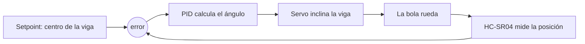

# Laboratorio 4 — Control PID, explicado

## El lazo de control

Hasta ahora los programas medían y mostraban. Acá por primera vez el programa **actúa sobre lo que mide**: la salida (inclinar la viga) cambia la próxima medición (la posición de la bola). Eso es un lazo cerrado de control.

Cada 40 ms el lazo hace lo mismo: mide dónde está la bola, calcula el error (`setpoint - posicion`), y con ese error decide cuántos grados inclinar la viga.

## Las tres acciones del PID

La salida es la suma de tres términos, y cada uno mira el error desde un tiempo distinto:

**P — Proporcional (el presente).** Corrige según el error de ahora: bola lejos del centro, viga muy inclinada; bola cerca, viga casi plana. Problema: la bola tiene inercia. Cuando llega al centro viene con velocidad, se pasa de largo, y el P la empuja de vuelta... oscila para siempre.

**D — Derivativo (el futuro).** Mira qué tan rápido cambia el error. Si la bola se acerca rápido al centro, el D inclina la viga **en contra** antes de que llegue: es el freno que evita que se pase de largo.

**I — Integral (el pasado).** Suma el error de todas las vueltas anteriores. Si la bola se queda quieta cerca del centro pero no exactamente (por fricción o porque la viga está desbalanceada), el error chico no alcanza para moverla con P solo. El I lo va acumulando hasta que la fuerza alcanza. Es el que elimina el error de régimen.

La ecuación de la guía, en su forma estándar:

> salida = Kp · [ e(t) + (1/Ti) ∫e·dt + Td · de/dt ]

`Ti` y `Td` son tiempos físicos (cuánto tarda el I en igualar al P, cuánto "proyecta hacia el futuro" el D). En el código usamos la forma algorítmica: **Ki = Kp/Ti** y **Kd = Kp·Td**.

## Dos detalles del código de `pid.c`

**Anti-windup.** El servo puede dar ±15 grados y nada más. Si la bola queda lejos un rato, la integral acumula y acumula un error que el servo no puede corregir; cuando la bola al fin cruza el centro, toda esa acumulación tarda muchísimo en descargarse y el sistema reacciona tarde. La solución: si el término I pide más que el límite del servo, se recorta el acumulador. La integral nunca "recuerda" más de lo que el actuador puede hacer.

**Capa de hardware.** El PID no sabe qué sensor ni qué servo hay: solo ve `LeerSensorDistancia()` y `ActualizarServo()`. Si mañana cambia el sensor, el algoritmo no se toca. Es la misma idea de librerías del lab 3.

## Por qué el lazo corre cada 40 ms (el tiempo de muestreo)

La guía pide Ts entre 20 y 50 ms, y las tres razones son límites físicos:

- **El sensor:** el eco del HC-SR04 tarda hasta unos milisegundos en volver; con un Ts muy corto el lazo correría sin dato nuevo.
- **El servo:** acepta un comando cada 20 ms (50 Hz). Correr el lazo más rápido es calcular salidas que el servo ignora.
- **El ruido del D:** con Ts muy chico, la posición casi no cambia entre muestras; dividir ese salto diminuto por un Ts diminuto hace que el término derivativo escupa picos enormes y el servo tiemble (*chattering*).

El lazo usa `HAL_GetTick()` como en los labs 2 y 3: nada bloquea, el `if` del tiempo decide cuándo toca correr.

## Cómo sintonizar en la maqueta (Ziegler-Nichols)

Todo se hace en modo Debug editando `pid_bola.kp`, `pid_bola.ki` y `pid_bola.kd` en Live Expressions, sin recompilar:

1. **Aislar el P:** poner `ki = 0` y `kd = 0`.
2. **Buscar la oscilación crítica:** subir `kp` de a poco hasta que la bola oscile de forma sostenida, sin crecer ni amortiguarse. Ese `kp` es la **ganancia crítica Ku**.
3. **Medir el período:** cronometrar una oscilación completa de la bola (ida y vuelta). Ese tiempo es el **período crítico Tu**, en segundos.
4. **Calcular:**
   - `kp = 0.6 × Ku`
   - `ki = kp / (0.5 × Tu)`
   - `kd = kp × (0.125 × Tu)`
5. Cargar los tres valores y ver cómo responde. Cuando convenza, pasarlos a los `#define` de `main_balancin.c` para que queden grabados.

### Ajuste fino: si pasa esto, tocá esto

| Síntoma | Causa probable | Qué tocar |
|---|---|---|
| La bola oscila sin parar | Mucho P o poco D | Bajar `kp` o subir `kd` |
| Se pasa de largo y vuelve (sobreimpulso) | Falta freno | Subir `kd` |
| Queda quieta pero fuera del centro | Falta integral | Subir `ki` de a poco |
| Tarda mucho en centrarse después de estar lejos | Windup o mucho I | Bajar `ki` (el anti-windup ya ayuda) |
| El servo tiembla con la bola quieta | Ruido del sensor en el D | Bajar `kd`, o subir Ts |
| Corrige para el lado equivocado | Signo invertido | Cambiar el signo de `SERVO_US_POR_GRADO` |

## La idea que cierra los cuatro labs

El lab 2 enseñó a no bloquear, el lab 3 a medir con librerías, y este junta todo y le agrega la vuelta: el dato medido vuelve al hardware como acción. El super-loop no bloqueante no era un capricho: un PID necesita correr a intervalos **exactos y regulares** (el Ts está dentro de las fórmulas de I y D), y eso solo se puede garantizar si ninguna otra tarea frena el lazo.
