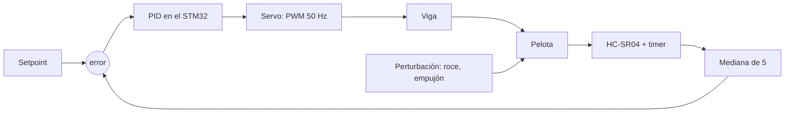

# Lab 4: resumen para defender en el final

Este resumen junta todo lo que hay que saber para defender el ball and beam: la teoría de las dos clases, cómo se aplica en la maqueta y qué decidí en el código. Al final hay preguntas probables con respuestas cortas y videos para profundizar.

**Material de la cátedra:**
- Clase de PID: [`teoria/03-control-pid/pid-basics.pdf`](../teoria/03-control-pid/pid-basics.pdf)
- Clase de conversores A/D: [`teoria/04-conversores-ad/conversores-analogico-digitales.pdf`](../teoria/04-conversores-ad/conversores-analogico-digitales.pdf)
- Guía del lab: [`consigna/Control PID - Ball and Beam.pdf`](./consigna/Control%20PID%20-%20Ball%20and%20Beam.pdf)

**Del lab:** [`explicacion.md`](./explicacion.md) (PID y sintonía), [`setup.md`](./setup.md) (cableado y variables), [`ensayos/`](./ensayos) (datos) e [`informe/reporte_modelo.pdf`](./informe/reporte_modelo.pdf) (modelo físico).

---

## 1. El sistema en una frase

Un sensor ultrasónico mide dónde está la pelota, el micro calcula el error respecto del setpoint y un PID decide cuántos grados inclinar la viga con un servo. Esto se repite cada 50 ms. Es un **lazo cerrado**: lo que hace el actuador cambia la próxima medición.

Vocabulario de la clase (diapositiva 3 de `pid-basics`):

| Nombre | Símbolo | En la maqueta |
|---|---|---|
| Referencia (set point) | SP | `setpoint_cm`, normalmente 0 = centro |
| Error | E = SP − C | `setpoint_cm - posicion_cm` |
| Control | U | `salida_angulo`, en grados de servo |
| Salida | C | posición de la pelota, en cm |
| Planta | | viga + pelota (y el servo) |
| Perturbación | N | roce, viga despareja, un empujón con la mano |

---

## 2. La planta: por qué el ball and beam es difícil

Si la viga se inclina un ángulo θ, la pelota acelera. Para una esfera maciza que rueda sin deslizar:

> a = (5/7) · g · sen θ ≈ 7 m/s² · sen θ

El 5/7 aparece porque parte de la energía se va en hacer girar la pelota. Para ángulos chicos, sen θ ≈ θ, así que **la aceleración es proporcional al ángulo**.

La consecuencia importante: el ángulo no fija la **posición**, fija la **aceleración**. Para pasar de aceleración a posición hay que integrar dos veces. En Laplace:

> G(s) = X(s) / θ(s) = K / s²   (doble integrador)

Esto explica casi todo:

- **Con P solo oscila para siempre.** El lazo queda s² + K·Kp = 0, que tiene polos en ±j√(K·Kp): son imaginarios puros, una oscilación que no crece ni se apaga. Ningún Kp la arregla.
- **El D es obligatorio.** Con PD el lazo queda s² + K·Kd·s + K·Kp = 0. El término en s es amortiguamiento: el D funciona como un freno.
- **El I es delicado.** Agrega otra integración más y empeora la estabilidad (la clase lo dice: "la estabilidad empeora").

**El modelo que medí** (`ensayos/2026-11-24/`, `informe/reporte_modelo.pdf`): ajusté a = K·(ángulo − ang0) − b·v, a veces con roce estático. Me dio K entre 0,8 y 1,8 cm/s² por grado de servo. Eso es mucho menos que los 12 cm/s² por grado que daría la fórmula si la viga girara igual que el servo, lo que sugiere que la viga gira bastante menos que el servo (por la palanca) y que hay roce. Además el modelo predijo poco. Por eso las ganancias finales salieron de probar en la maqueta.

**Problemas reales de esta maqueta:**
- **Roce estático (stick-slip):** la pelota se queda pegada y, cuando se suelta, sale de golpe. Cerca de +3,7 cm se trababa siempre.
- **Zona muerta del servo y la viga:** entre 1350 y 1700 µs la pelota quieta no se movía.
- **Ruido del sensor:** picos de varios cm en el 7 % de las lecturas.
- **Retardo:** entre la medición, el filtro y la velocidad limitada del servo hay del orden de 100 a 150 ms de retardo, que también desestabiliza.

---

## 3. El controlador PID

### 3.1 La ecuación (clase, diapositivas 4 y 5)

Forma paralela, la que usa el código:

> u(t) = Kp·e(t) + Ki·∫e(t)dt + Kd·de(t)/dt

Forma estándar (o ideal), con constantes de tiempo:

> u(t) = Kp·[ e(t) + (1/Ti)·∫e(t)dt + Td·de(t)/dt ]

Equivalencias: **Ki = Kp/Ti** y **Kd = Kp·Td**.

- **Ti (tiempo de integración):** el tiempo que tarda la acción integral en igualar a la proporcional, con un error constante. Ti chico significa una integral más agresiva.
- **Td (tiempo de derivación):** el tiempo que tarda la acción derivativa en igualar a la proporcional. Es cuánto "mira hacia adelante" el controlador. Td grande significa más freno.

### 3.2 Qué hace cada acción (clase, diapositivas 6 a 8)

| Acción | Mira | Efecto según la clase | En la pelota |
|---|---|---|---|
| **P** | el presente: el error ahora | Al subir Kp baja el error de régimen, sube la velocidad y **sube el sobrepico** | Más lejos, más inclinación. Solo, oscila |
| **I** | el pasado: la suma de errores | **Elimina el error de régimen**, pero **la estabilidad empeora** y sube el sobrepico | Si queda trabada cerca del centro, va sumando hasta moverla |
| **D** | el futuro: la velocidad del error | **Mejora la estabilidad**, **baja el sobrepico** y sube la velocidad de respuesta | Si se acerca rápido, inclina en contra antes de que llegue |

**Historia (diapositiva 2):** Minorsky analizó el controlador de tres términos en 1922 para gobernar barcos. Taylor Instrument Company lo vendió en 1936 con derivativa fija y en 1939 con derivativa ajustable. Hoy más del 95 % de los lazos de control son PID: es la extensión natural del control ON-OFF.

### 3.3 Del PID continuo al PID en el micro (discretización)

El micro no hace integrales ni derivadas: trabaja con muestras cada Ts = 0,05 s.

| Continuo | Discreto (en `pid.c`) |
|---|---|
| ∫e dt | `integral += ki * error * ts` (suma de rectángulos) |
| de/dt | `(medida - medida_previa) / ts` (diferencia hacia atrás) |

Por eso **Ts aparece dentro de las fórmulas**: si el lazo no corre a intervalos regulares, la I y la D calculan mal. Por eso el lazo es no bloqueante y se controla con `HAL_GetTick()`.

### 3.4 Las decisiones de mi `pid.c` (para defender línea por línea)

1. **Derivada sobre la medida, no sobre el error.** Uso −Kd·(velocidad de la pelota). Con setpoint fijo es lo mismo, porque de/dt = −dx/dt. Pero si el setpoint salta (ensayo de escalón), la derivada del error sería enorme durante una muestra (*derivative kick*) y el servo pegaría un golpe. Derivando la medida, eso no pasa.
2. **Velocidad filtrada** (`alfa_vel = 0,85`): `vel = 0,85·vel_anterior + 0,15·vel_nueva`. Es un filtro pasa-bajos de primer orden (promedio móvil exponencial). Con Ts = 50 ms, su constante de tiempo es τ = −Ts/ln(0,85) ≈ 0,31 s y su frecuencia de corte es de alrededor de 0,5 Hz. Hace falta porque el ruido del sensor dividido por Ts se agranda: 0,4 cm de ruido / 0,05 s = 8 cm/s de velocidad falsa. La contra es que el freno llega un poco tarde.
3. **Anti-windup.** Si el servo está al tope (±20°) y el error sigue empujando hacia ese tope, la integral no acumula. Sin esto, la integral se "carga" mientras la pelota no se puede corregir y, cuando cruza el setpoint, tarda muchísimo en descargarse y la pelota se pasa (*windup*). La guía de la cátedra lo hace recortando el término I. Yo lo hago con integración condicional, y además recorto la integral al rango de salida.
4. **Integral guardada ya multiplicada por Ki** (en grados). Así puedo cambiar Ki en vivo sin que la salida pegue un salto.
5. **Salida saturada** a ±`LIMITE_GRADOS`, que es el límite físico del actuador.

### 3.5 Lo que agregué en `main_balancin.c` (y por qué no es trampa)

El PID puro no alcanzó por el roce estático y el ruido. Agregué dos cosas, y las dos se pueden apagar en vivo poniéndolas en 0:

- **Banda de 1 cm** (`banda_cm`): si el error es menor a 1 cm, el PID recibe error cero. Así deja de corregir el ruido cerca del setpoint y el servo no da golpecitos. El D sigue frenando. Es la misma idea que la **histéresis o zona muerta** del ON-OFF de la clase.
- **Empuje en rampa** (`rampa_empuje`, `empuje_max`): si la pelota está quieta fuera de la banda, sumo un ángulo que crece 10 °/s hacia el setpoint, hasta 12°. Cuando se despega, se borra rápido. Es una **compensación de roce**: hace a propósito lo que la integral haría sola, pero sin cargarse. Por eso Ki quedó en 0,05: con Ki 0,4, la integral se cargaba mientras la pelota estaba trabada y al soltarse la disparaba.

Si preguntan si sigue siendo un PID: sí. El PID calcula la acción y estas dos reglas compensan dos no linealidades de la planta (ruido y roce). En la industria se hace lo mismo con la zona muerta, la compensación de fricción y el *feedforward*.

### 3.6 Sintonía

**Ziegler-Nichols de lazo cerrado** (guía de la cátedra):
1. Ki = 0 y Kd = 0.
2. Subir Kp hasta lograr una oscilación sostenida: esa es la **ganancia crítica Ku**.
3. Medir el período de esa oscilación: el **período crítico Tu**.
4. Calcular **Kp = 0,6·Ku**, **Ti = 0,5·Tu** y **Td = 0,125·Tu**, y de ahí Ki = Kp/Ti y Kd = Kp·Td.

**En esta maqueta, ZN no sirve tal cual.** Con P solo, el doble integrador oscila con cualquier Kp, así que no hay un Ku claro. Además, el roce hace que la oscilación dependa de la amplitud. Por eso usé:
- Un **modelo identificado** a partir de ensayos en lazo abierto, y una simulación para buscar ganancias (opción A). En la maqueta falló.
- **Ajuste manual con criterio**: la tabla "si pasa esto, tocá esto" de `explicacion.md`, con ensayos medidos y limitados por seguridad.

Valores finales: **Kp 1,5 / Ki 0,05 / Kd 2**, Ts 50 ms, ±20°, servo a 60 °/s, horizontal en 1580 µs.

Comparados con la guía (Kp 1,5 / Ki 0,2 / Kd 0,05), el **Kd es 40 veces mayor**. Tiene sentido: el doble integrador necesita mucho freno, y mi D está filtrado, así que no amplifica tanto el ruido.

**Unidades de las ganancias** (aparecen en `pid.h`): Kp en grados/cm, Ki en grados/(cm·s) y Kd en grados/(cm/s).

### 3.7 Resultados (para mostrar con honestidad)

Pasada por setpoints (`ensayos/2026-11-25/sp1.csv`):
- En +4 y +8 cm la pelota quedó dentro de 1 cm entre el 91 y el 100 % del tiempo.
- En 0, −4 y −8 cm osciló de 1 a 2 cm (entre el 22 y el 43 % del tiempo dentro de 1 cm). En el primer tramo en 0 la pelota ya estaba quieta dentro de la banda, así que ese 100 % no cuenta.
- Nunca se fue a las puntas: estuvo entre −11,8 y +8,6 cm.

Conclusión: controla, pero no tiene precisión de 1 cm en todo el recorrido. La asimetría entre los dos lados puede venir de la horizontal, del roce o de la viga despareja; no lo probé.

---

## 4. Tiempo de muestreo (Ts)

Ts = 50 ms, o sea fs = 20 Hz. Criterios de la guía:

- **Teórico:** Ts entre 10 y 30 veces más rápido que la dinámica, Ts ≈ Tu/10 a Tu/20. La pelota tarda del orden de un segundo en cruzar la viga, así que 50 ms entra.
- **Sensor:** el eco tiene que volver antes de disparar de nuevo. A 55 cm, el eco tarda 55 × 58,3 ≈ 3,2 ms. Pero los ecos viejos rebotan un tiempo, y disparar muy seguido mezcla ecos.
- **Actuador:** el servo recibe un pulso cada 20 ms (50 Hz). Calcular más rápido es desperdiciar CPU.
- **Ruido en el D:** con Ts muy chico, la diferencia entre muestras es casi todo ruido, y al dividir por Ts el D da picos (*chattering*).

**Relación con Nyquist** (clase de conversores): con fs = 20 Hz, la frecuencia de Nyquist es fs/2 = 10 Hz. La pelota se mueve mucho más lento (alrededor de 1 Hz o menos), así que el teorema se cumple con margen. La clase recomienda en la práctica fs ≈ 8·fm o más para reconstruir bien la señal: también se cumple.

---

## 5. Sensor: HC-SR04 con Input Capture

**Cómo mide:**
1. Un pulso de 10 µs en TRIG (PB0) hace que el sensor emita 8 ciclos de ultrasonido a 40 kHz.
2. ECHO (PB1) se pone en alto hasta que vuelve el rebote. **El ancho del pulso es proporcional a la distancia.**
3. d = t · v_sonido / 2, porque el sonido va y vuelve. Con v = 343 m/s, d [cm] = t [µs] / 58,3.

**Cómo lo mido en el micro:** TIM3 canal 4 en modo **Input Capture**, con prescaler 48 sobre 48 MHz, así que cuenta 1 µs por tick.
- En el flanco de subida guardo el contador y cambio la polaridad a flanco de bajada.
- En el flanco de bajada guardo el contador y resto. Si el contador desbordó entre medio, lo corrijo.

El hardware congela el valor del contador en el instante exacto del flanco, así que la medición no depende de cuánto tarde la interrupción en atenderse. Además no bloquea: disparo, sigo con el lazo y en la vuelta siguiente leo el resultado.

**Resolución:** 1 µs / 58,3 ≈ **0,017 cm**. Es mucho mejor que el ruido real, de unos 0,4 cm. El límite está en el sensor, no en el timer.

**Errores típicos:** la velocidad del sonido cambia unos 0,6 m/s por °C (≈ 0,17 %/°C); los ecos rebotan en otras cosas; una pelota redonda devuelve poco eco. Si no hay eco válido, cuento una falla. Con 5 fallas seguidas considero que no hay pelota: la viga va a horizontal y el PID se reinicia.

**Filtro de mediana de 5:** ordeno las últimas 5 lecturas y me quedo con la del medio. Un pico aislado queda en una punta y se descarta. Un promedio, en cambio, lo repartiría entre todas las muestras. La mediana es un filtro **no lineal**. Su costo es un retardo de alrededor de 2 muestras (100 ms).

---

## 6. Actuador: servo por PWM

- TIM2 canal 2 (PA1) en modo PWM: prescaler 47 sobre 48 MHz da 1 µs por cuenta, y período 20000 µs, o sea **50 Hz**.
- **El ancho del pulso fija el ángulo**: típicamente 1000 a 2000 µs para 90° (11,1 µs/°). El servo tiene su propio lazo de control interno, con un potenciómetro y un motor.
- **Pulso = 1580 − 11,1 · ángulo.** 1580 µs es la viga horizontal. El signo depende de cómo está montado (`sentido = −1`).
- **Límites:** ±20°, además de un recorte por seguridad entre 700 y 2300 µs. Con ±35° los movimientos eran muy bruscos para la maqueta.
- **Velocidad limitada a 60 °/s** (`Servo_Update` cada 20 ms): el servo avanza como mucho 1,2° por período. Con 150 o 300 °/s los movimientos fueron violentos. La contra es que limitar la velocidad agrega retardo al lazo.

---

## 7. Conversores A/D (clase de conversores)

**En este lab no se usa el ADC**: la posición se mide como un tiempo, con un timer. Pero es una pregunta probable, por dos motivos: en el lab 3 el LM35 sí usaba el ADC, y la medición del HC-SR04 se parece a un conversor.

### 7.1 Muestreo y mantenimiento (Sample & Hold)

- Mientras el ADC convierte, la entrada tiene que quedarse quieta. El S/H es una **memoria analógica**: una llave y un capacitor C_H.
- **Muestreo** (llave cerrada): C_H se carga con τ = R_ON · C_H. Para un error del 1 % hacen falta 5τ, y para un 0,1 %, 7τ. Se usa un C_H chico (10 a 30 pF) para que cargue rápido.
- **Mantenimiento** (llave abierta): C_H tiene que conservar el valor. Si se conecta directo al ADC, se descarga a través de la entrada del ADC. Por eso se pone un seguidor de tensión (buffer con operacional) a la salida.
- En el STM32 el S/H está dentro del ADC. El "sampling time" que se configura (en el lab 3, `ADC_SAMPLETIME_480CYCLES`) es justamente el tiempo de carga de C_H. Con una fuente de alta impedancia hacen falta más ciclos.

### 7.2 Teorema del muestreo y aliasing

- **Nyquist: fs ≥ 2·fm.** En la práctica se usa bastante más (la clase muestra fs = 8·fm).
- **Aliasing:** si entra una frecuencia mayor que fs/2 (ruido, por ejemplo), aparece como una frecuencia falsa más baja dentro de la banda útil, y después ya no se puede separar.
- **Filtro anti-aliasing:** un pasa-bajos **analógico, antes del ADC**, con corte en fh = fs/2. Tiene que ser analógico: una vez muestreada la señal, el alias ya está mezclado.
- **Ejemplo de la clase, una onda cuadrada:** tiene armónicas impares. Si quiero conservar hasta la 7ª, fs ≥ 2 × 7·f y el filtro corta en la 7ª armónica.

### 7.3 ADC ideal y cuantización

- Vin = Vref · B / 2ᴺ, con B = b₀·2⁰ + b₁·2¹ + … + b_(N−1)·2^(N−1). b₀ es el bit menos significativo (LSB).
- **V_LSB = Vref / 2ᴺ.** Todo un rango de tensiones da el mismo código: ese es el **error de cuantización**, de ±½ LSB.
- **Ejemplo del lab 3:** ADC de 12 bits con 3,0 V da 3,0 / 4096 ≈ 0,73 mV por cuenta. Con el LM35 (10 mV/°C) son unos **0,07 °C por cuenta**.
- **Ejemplo de este lab:** el timer cuantiza el tiempo en 1 µs, lo que equivale a 0,017 cm por cuenta.

### 7.4 Tipos de ADC

| Tipo | Cómo funciona | Velocidad | Precisión y uso |
|---|---|---|---|
| **Simple rampa** | Una rampa sube desde 0 y un contador cuenta pulsos de reloj hasta que la rampa iguala a Vin: N = fc·T = fc·τ·Va/Vr | Lenta, depende de Vin | Depende de τ = RC y del reloj, que derivan con la temperatura. Simple pero poco preciso |
| **Doble rampa (integrador)** | Fase 1: integra −Vin durante un T1 fijo. Fase 2: integra Vref hasta volver a 0 y cuenta T2. Resultado: **T2 = T1·Vin/Vref** | Lenta | **Muy precisa**: R, C y el reloj se cancelan, y solo importa Vref. Si T1 es un múltiplo de 20 ms, rechaza el ruido de 50 Hz. Se usa en multímetros |
| **Aproximaciones sucesivas (SAR)** | Búsqueda binaria: prueba el bit más significativo con un DAC interno y un comparador, decide, y sigue con el siguiente | t_conv = N·T_CLK ideal, **(N+2)·T_CLK real** (un ciclo de inicio y uno de latch) | Equilibrio entre velocidad y resolución. **Es el ADC del STM32** (12 bits) |
| **Flash** | **2ᴺ − 1 comparadores** en paralelo contra una escalera de resistencias: convierte en un solo paso | La más rápida | Muchos comparadores, así que pocos bits (8 o menos). Se usa en osciloscopios y video |
| **Flash de dos etapas** | Un flash grueso con los bits altos, un DAC lo resta, y un segundo flash convierte el resto con los bits bajos | Rápida | Muchos menos comparadores que un flash completo |

**Conexión con el lab:** medir el eco con un timer es **convertir un tiempo en un número contando pulsos de reloj**, igual que la última etapa del simple rampa (N = fc·T). En los dos casos la resolución la da la frecuencia del reloj: acá 1 MHz, o sea 1 µs.

---

## 8. Firmware: cómo encaja todo

| Periférico | Para qué | Configuración |
|---|---|---|
| TIM3 CH4, Input Capture (PB1) | Ancho del eco del HC-SR04 | 1 µs por tick, interrupción con prioridad 0 (la más urgente) |
| GPIO PB0 | TRIG | Pulso de 10 µs |
| TIM2 CH2, PWM (PA1) | Servo | 50 Hz, pulso en µs |
| TIM4 + USART2 (PA2) | Gráfico en la PC | Interrupción cada 50 ms, envío no bloqueante (`HAL_UART_Transmit_IT`) a 115200 baudios, prioridad 1 |
| GPIO PD12 a PD15 | LEDs | Rojo: sin pelota. Verde: a menos de 1 cm. Azul: controlando |

**Super-loop no bloqueante:** el `while(1)` pregunta si ya pasaron 50 ms (`HAL_GetTick()`). Si pasaron, lee el sensor, calcula el PID y manda el ángulo. En todas las vueltas llama a `Servo_Update`. Nada usa `HAL_Delay`, así el Ts es regular. Es lo del lab 2 aplicado a control.

**Capa de abstracción:** el PID no sabe qué sensor ni qué servo hay; solo usa `LeerSensorDistancia()` y `ActualizarServo()`. Si cambio de sensor, el algoritmo no se toca. Es lo del lab 3.

**`volatile`:** las variables que cambio en vivo desde el depurador (Live Expressions) son `volatile` para que el compilador las lea de memoria cada vez y no use una copia vieja.

**Seguridad:** arranca en modo 0 (viga horizontal, sin control). Si no ve la pelota durante 5 muestras, pone la viga horizontal y reinicia el PID (`PID_Reset`), para que no quede integral vieja.

---

## 9. Preguntas probables y respuestas cortas

**¿Por qué con P solo la pelota oscila siempre?**
Porque la planta es un doble integrador (K/s²). Con P, los polos quedan sobre el eje imaginario: es una oscilación pura. Hace falta el D para amortiguar.

**¿Qué pasa si saco el D?**
Oscila sin parar o se va a las puntas.

**¿Qué pasa si subo mucho el D?**
Amplifica el ruido del sensor y el servo tiembla. Por eso filtro la velocidad.

**¿Para qué está la I, si casi no la uso?**
Para corregir el error que queda por la viga despareja o el roce. En esta maqueta, con Ki alto la integral se cargaba con la pelota trabada y la disparaba. Por eso Ki es chico y el empuje en rampa hace ese trabajo de forma controlada.

**¿Qué es el windup y cómo lo evitás?**
Es la integral acumulándose mientras el actuador está saturado. Lo evito no integrando si la salida está al tope y el error empuja hacia el tope, y recortando la integral al rango de salida.

**¿Por qué derivás la medida y no el error?**
Para que un salto del setpoint no genere un golpe de derivada. Con setpoint fijo es igual.

**¿Por qué Ts = 50 ms y no 1 ms?**
Por el sensor (ecos), por el servo (50 Hz) y por el ruido en el D. Y cumple Nyquist con margen frente a la dinámica de la pelota.

**¿Qué es Ti? ¿Y Td?**
Ti es el tiempo en que la I iguala a la P con error constante; Ki = Kp/Ti. Td es el tiempo en que la D iguala a la P; Kd = Kp·Td.

**¿Cómo funciona Ziegler-Nichols? ¿Lo usaste?**
Se sube Kp hasta la oscilación sostenida (Ku, Tu), y después Kp = 0,6 Ku, Ti = 0,5 Tu, Td = 0,125 Tu. No lo usé tal cual: en un doble integrador con roce no hay un Ku bien definido. Usé un modelo y ajuste manual medido.

**¿Por qué mediana y no promedio?**
Porque el sensor da picos aislados. La mediana los descarta; el promedio los reparte y los pasa al D.

**¿Cómo medís el ancho del eco sin bloquear?**
Con Input Capture: el hardware guarda el valor del contador en cada flanco y la interrupción solo resta.

**¿Cuál es la resolución del sensor?**
La del timer es 1 µs, o sea 0,017 cm. El ruido real es de unos 0,4 cm, así que manda el sensor.

**¿El STM32 tiene ADC? ¿De qué tipo?**
Sí: SAR de 12 bits con S/H interno. En el lab 3 lo usé con el LM35, con 0,73 mV por cuenta.

**¿Por qué un filtro anti-aliasing tiene que ser analógico?**
Porque después de muestrear, el alias ya cayó dentro de la banda y no se puede separar de la señal.

**¿Qué ADC usarías para un multímetro? ¿Y para un osciloscopio?**
Para el multímetro, doble rampa: es preciso y rechaza 50 Hz. Para el osciloscopio, flash, por velocidad.

**¿Por qué el doble rampa no depende de R ni de C?**
Porque la misma RC integra en las dos fases y se cancela: T2 = T1·Vin/Vref.

**¿Cuánto tarda un SAR de 12 bits?**
Unos 12 ciclos de reloj en el caso ideal y 14 en el real (N + 2).

**¿Qué agregaste además del PID y por qué?**
Una banda de 1 cm (contra el ruido) y un empuje en rampa (contra el roce estático). Las dos se apagan en vivo.

**¿Funciona?**
Controla y no se va a las puntas. Del lado lejano queda dentro de 1 cm; en el centro y del lado del sensor oscila 1 a 2 cm.

---

## 10. Videos para entender a fondo

Elegí estos videos por título, descripción y canal; no los miré enteros. La serie de MATLAB (Brian Douglas) es la más recomendada para control.

### Control PID

| Video | Idioma | Por qué verlo |
|---|---|---|
| [Understanding PID Control, Part 1: What Is PID Control?](https://www.youtube.com/watch?v=wkfEZmsQqiA) (MATLAB, Brian Douglas) | Inglés | La mejor intuición de P, I y D, sin matemática pesada |
| [¿Qué es el control PID?](https://www.youtube.com/watch?v=oQqdbUm-ImA) (MATLAB) | Español | Versión en español del anterior |
| [Anti-windup for PID control](https://www.youtube.com/watch?v=NVLXCwc8HzM) (MATLAB) | Inglés | Exactamente lo que hace `pid.c` cuando el servo satura |
| [Noise Filtering in PID Control](https://www.youtube.com/watch?v=7dUVdrs1e18) (MATLAB) | Inglés | Por qué hay que filtrar el D: mi `alfa_vel` |
| [Manual and Automatic PID Tuning Methods](https://www.youtube.com/watch?v=qj8vTO1eIHo) (MATLAB) | Inglés | Métodos de sintonía, incluido el ajuste a mano |
| [PID Tuning: The Ziegler Nichols Method Explained](https://www.youtube.com/watch?v=nvAQHSe-Ax4) | Inglés | Ziegler-Nichols en pocos minutos |
| [Control PID, explicación sencilla](https://www.youtube.com/watch?v=uIBbIe7IcW4) | Español | Repaso rápido sin cálculo |
| [Ball and Beam. Arduino PID control](https://www.youtube.com/watch?v=chl28kbvz7Y) | Inglés | Otra maqueta como la nuestra, con sensor ultrasónico |

### Sensor y actuador

| Video | Idioma | Por qué verlo |
|---|---|---|
| [HC-SR04 Ultrasonic Sensor Explained](https://www.youtube.com/watch?v=fnSAyWHP0L4) | Inglés | Cómo mide el sensor, TRIG y ECHO |
| [STM32 Tutorial: Use Multiple Ultrasonic Sensors HC-SR04](https://www.youtube.com/watch?v=Jmjtri25QWo) | Inglés | HC-SR04 con timers del STM32 |
| [Medidor de distancia con HC-SR04 y STM32](https://www.youtube.com/watch?v=rqRX1h2vleU) | Español | Input Capture para el eco |
| [How Servo Motors Work & How To Control Servos](https://www.youtube.com/watch?v=LXURLvga8bQ) | Inglés | Por dentro del servo y el pulso de 1 a 2 ms |
| [RC Servo PWM and Frequency Demonstration](https://www.youtube.com/watch?v=aRstYcbsCO0) | Inglés | El PWM de 50 Hz en el osciloscopio |

### Conversores y muestreo

| Video | Idioma | Por qué verlo |
|---|---|---|
| [Visualizing Aliasing and the Shannon Nyquist Sampling Theorem](https://www.youtube.com/watch?v=QJuSd1hhBws) | Inglés | El aliasing visto en animación |
| [Aliasing and Anti-aliasing, Nyquist sampling: a practical approach](https://www.youtube.com/watch?v=SzaFo8EMHyA) | Inglés | El filtro anti-aliasing en la práctica |
| [What is Sample and Hold?](https://www.youtube.com/watch?v=8OGncimlICw) | Inglés | Muestreo y mantenimiento |
| [SAR: aproximaciones sucesivas, conversor análogo digital](https://www.youtube.com/watch?v=CN9DqOctC-0) | Español | El ADC del STM32 |
| [Successive Approximation ADC Explained](https://www.youtube.com/watch?v=h0CGtr4SC9s) | Inglés | SAR paso a paso con 4 bits |
| [Dual slope Analog to Digital Converter](https://www.youtube.com/watch?v=knI_Zpsv9TI) | Inglés | Las dos fases del doble rampa |
| [ADC: Successive Approximation, Flash type](https://www.youtube.com/watch?v=-lZKK0MvJxc) | Inglés | Flash y SAR comparados |

**Orden sugerido:** MATLAB parte 1 (o la versión en español), después anti-windup y filtrado de ruido, Ziegler-Nichols, el HC-SR04, Nyquist y por último los ADC SAR y doble rampa.
